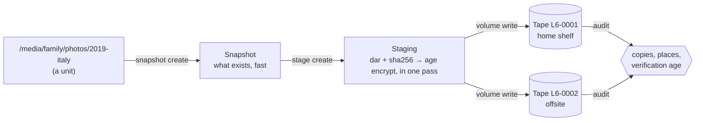

# tapectl

**Long-term, encrypted, multi-tenant archiving to LTO tape — built so the tapes can be
read back decades later, by someone else, without tapectl.**

tapectl turns directories into encrypted archives (`dar` + `age`), plans each tape
before writing it, writes it in one verified session, and keeps a catalog of what is
where: which files, which version, which cartridge, on which shelf, in how many
copies. Every tape carries its own recovery instructions, so the data outlives the
software, the database and the machine that wrote it.



## Found this from a tape?

You do not need this repository to get the data back.

- **Start with the tape.** File 0 says how to read File 1, a complete recovery guide
  written for a person or an AI assistant. File 2 is `RESTORE.sh`, which restores with
  `mt`, `dd`, `age`, `dar` and a few standard tools. Neither needs tapectl.
- **If you have the Heir Kit**, its `tapectl-X.Y.Z` file is a ready-built copy of the
  program, for Linux on the machine type the cover sheet names. Check it against the
  sha256 on the sheet. It saves you a build.
- **To build tapectl**, check out the release that File 0's `tapectl_version` names
  (`git checkout vX.Y.Z`), or a newer one. The documents on `master` describe the newest
  release.
- **The heir's page** is [Keys and recovery, "For the heir"](docs/keys-and-recovery.md#for-the-heir-no-tapectl-no-catalog).
  Its [runbook B](docs/keys-and-recovery.md#b-a-tenant-holding-only-their-key-files-and-a-tape)
  restores from a key and a tape, and
  [runbook C](docs/keys-and-recovery.md#c-the-catalog-is-gone-and-you-hold-the-operator-or-escrow-key)
  rebuilds the catalog from the tapes.

## Status

tapectl 1.8.1 (tagged `v1.8.1`, 2026-11-01) is the current release. It is young: in real
use since 1.0.0 (2026-10-01), and proven on one drive model, an HP LTO-6. Other drives
have been exercised only in a virtual tape library (mhvtl).

The newest features each passed an acceptance run on a real HP LTO-6 drive before their
release was tagged: the short seal (1.6.0, 2026-10-22), spanning (1.7.0, 2026-10-27) and
Logical Block Protection (1.8.0, 2026-10-29). Before them, from the full real-drive
validation of 2026-09-10 on, it was proven end to end on the same drive: writes,
verification, every restore path including the heir's script off the tape, and catalog
rebuild from tape. The on-tape format is pinned by byte-level tests, and a change to it
is a decision recorded in the [ADRs](docs/adr/). The last full test run passed about
4,600 tests. What each release changed is in [docs/releases/](docs/releases/).

## Why tapectl

- **Self-describing tapes.** Each tape begins with a plaintext guide, a `RESTORE.sh`
  and a map of every file on it. With the right key, the data comes back with `mt`,
  `dd`, `age`, `dar`, `sha256sum`, `head`, `truncate`, `tar`, `mkfifo` and `tee` alone
  — no database, no tapectl.
- **Tenants that cannot read each other.** Family, business, a friend's backups: each
  tenant has its own keys, and nothing about a tenant's content — not even file
  names — is written to tape in plaintext.
- **A key you can put in an envelope.** A permanent *escrow* key, printed once and kept
  on paper, can decrypt every tape and, if the machine is lost, rebuild from each tape
  what the catalog knew about it when it was written. Where each cartridge is kept,
  its verification history and your policy are not on any tape: they come back from
  the encrypted catalog in the printed **Heir Kit** (as of its last refresh), which
  also tells whoever finds it what to do.
- **Plan first, write once.** The whole tape is planned before the first byte and
  written in one session, which ends with a seal marker that binds the front index.
  A tape is recorded as sealed only when its seal binds its front index and the
  read-back agrees, and a sealed tape is never appended to. A write that reaches the
  drive's early warning finishes the slice in flight and seals the tape short: a unit
  it did not finish stays staged and is written whole on the next tape. A unit is never
  split across tapes unless it opts into spanning. `--full-confirm` reads every byte
  back at write time; otherwise the `volume verify` that follows is the tape's first
  full read-back, and `audit` names the tape (`no_full_verify`) until one passes.
- **The drive checks every block.** On a drive with Logical Block Protection, the drive
  checks a CRC on every block tapectl writes, and each volume records whether its write
  was checked.
- **It knows where everything is.** Copies, locations, versions and verification
  history are tracked, and `audit` tells you what is short of your policy and the
  exact command that fixes it.

## A taste

```bash
TAPE=/dev/tape/by-id/scsi-<SERIAL>-nst                 # your drive, by serial: named once, in backend add

tapectl init --operator alice                            # write the printed escrow secret on paper
tapectl backend add --name lto6 --device-tape "$TAPE" --generation LTO-6
tapectl location add home-rack -d "the shelf beside the drive"
tapectl tenant add family -d "family photos and letters"
tapectl unit init-bulk /media/family/photos --tenant family

tapectl snapshot create family/photos/2019-italy         # fast: what is there
tapectl stage create family/photos/2019-italy            # dar + sha256 + age, into staging
tapectl volume init L6-0001                              # reads the cartridge's chip
tapectl volume write L6-0001 --full-confirm --move-to home-rack   # plan, write, seal, read it all back, shelve

tapectl audit --action-plan                              # "has 1 copies, needs 2" — and the fix
tapectl restore unit --unit family/photos/2019-italy --from L6-0001 --to /tmp/restore
```

The [walkthrough](docs/walkthrough.md) runs a complete session like this — two tapes,
two places, a restore, the Heir Kit and a disaster-recovery rehearsal — with the real
output of every command.

## Requirements

- **Linux** with the kernel `st` tape driver, and an **LTO drive** (tested on an HP
  LTO-6; one drive writes every generation it supports — each cartridge's generation is
  read from the cartridge). A virtual library
  ([mhvtl](docs/operator-guide.md#testing-with-a-virtual-tape-library)) works for
  trying things out.
- **`dar` ≥ 2.6** (2.7.20+ recommended), `mt-st`, `sg3-utils`, `acl`, `python3`,
  `lsscsi`. From `sg3-utils`, tapectl reads the cartridge's chip and the drive's health
  pages, and uses `sg_modes` and `sg_wr_mode` for Logical Block Protection (without
  them it writes without LBP and says so).
- **`age`** (the command-line tool, with `age-keygen`) is not used by tapectl, which
  encrypts with the `rage` library. It is needed for recovery — the on-tape
  `RESTORE.sh` (the heir's path), decrypting the Heir Kit's catalog, checking a typed
  escrow secret — and by the installer's rehearsal.
- Staging space for one tape's worth of data (up to 2.5 TB for a full LTO-6).
- Rust 1.94.1 to build (pinned in `rust-toolchain.toml`).
- The guided installer expects a **Debian/Ubuntu host with `sudo`**. It checks for
  `dar`, `mt-st`, `sg3-utils`, `acl`, `python3` and `lsscsi` and offers to install
  them with `apt`, and offers `age` from its upstream release.

## Install

The guided route builds a release binary, creates a dedicated `tapectl` service user
to own the keys and catalog, finds the drive by serial, walks you through the escrow
key and the Heir Kit, rehearses on a test cartridge, and writes your first tape:

```bash
git clone https://github.com/mikmorg/tapectl && cd tapectl
scripts/first-run.sh            # resumable: --from N / --to N; --help lists every step
```

**If you install from a [host profile](docs/install.md#host-profiles)**, a bash file of
the installer's answers for one machine (`contrib/hosts/` has examples), pass it on every
run, a one-step re-run included. The host remembers the profile it was installed with: a
later run without `--profile` refuses and names it, and `--profile none` runs without one.

```bash
scripts/first-run.sh --profile ~/myhost.profile
```

[docs/install.md](docs/install.md) is the runbook: what each step creates, how to
resume, reinstall, upgrade, move to a new host, or uninstall. To build by hand:
`cargo build --release` (binary at `target/release/tapectl`).

## Upgrading

An upgrade is done in place, from a checkout of the new release tag:
`scripts/first-run.sh --upgrade`. It backs the catalog up with the old binary and keeps
that binary, installs the new one (the catalog migrates at its first open, and there is
no downgrade past a migration), stops at each newer release's own steps, rehearses on a
test cartridge, regenerates the Heir Kit and prints the way back.
[docs/install.md, "Upgrading in place"](docs/install.md#10-upgrading-in-place) has the
steps.

## Documentation

| If you want to… | Read |
|---|---|
| See a whole session, start to finish | [Walkthrough](docs/walkthrough.md) |
| Understand the model: tenants, units, snapshots, volumes, copies | [Concepts](docs/concepts.md) |
| Install it properly | [Install](docs/install.md) |
| Upgrade to a new release | [Install, "Upgrading in place"](docs/install.md#10-upgrading-in-place) |
| Run it day to day: archive, copy, restore, compact, audit | [Operator guide](docs/operator-guide.md) |
| Restore a unit or a file | [Operator guide, "Restore"](docs/operator-guide.md#restore) |
| Configure it: every `config.toml` key, collections, policy | [Configuration](docs/configuration.md) |
| Understand the keys, the Heir Kit, and recover from a disaster | [Keys and recovery](docs/keys-and-recovery.md) |
| Read a tape you found, or inherited, without tapectl | [Keys and recovery, "For the heir"](docs/keys-and-recovery.md#for-the-heir-no-tapectl-no-catalog) |
| Make sense of a refusal or an error | [Troubleshooting](docs/troubleshooting.md) |
| Look up a command or flag | [Command reference](docs/cli/README.md) |
| See what a release changed | [Release notes](docs/releases/) |
| Know exactly what is on a tape | [On-tape format v2](docs/design/volume-format-v2.md) |
| Build, test or change tapectl | [Development](docs/development.md) |

The full index, including design records and test procedures, is
[docs/README.md](docs/README.md).

## What is on a tape

Every tape uses **Layout Version 2**
([specification](docs/design/volume-format-v2.md)):

| File | Contents | Encrypted? |
|---|---|---|
| 0 | ID thunk: label, uuid, the tapectl version that wrote it, `requires` (the features a reader must know, such as `short-seal` and `spanning`), where the index and the seal are, the cartridge's identity | No |
| 1 | Recovery guide (Markdown, written for a human or an AI assistant) | No |
| 2 | `RESTORE.sh` — scripted recovery | No |
| 3 | Front index: every file's position, type, size and ciphertext sha256 | No |
| 4 … | Envelopes: one per tenant (its file lists and restore recipe), then the operator's (the catalog) and its backup copy, then a backup copy of each tenant's. Each carries an index of the archive: for a tenant, which tapes hold each version of its units, and every path; for the operator, the same map for every tenant's units, without paths | Yes |
| … | Data slices (`dar` archives) | Yes |
| last | Seal marker: binds the front index. A write that reached the drive's early warning ends with a short seal, which says where the tape ended | No |

Nothing in the plaintext files says what the data *is* — no names, no paths, no
tenants. A tape without its seal marker was never finished and says so. The tenant
envelopes' backup copies are on tapes from 1.1.0, the envelopes' index from 1.3.0, and
the short seal from 1.6.0.

## Contributing

```bash
cargo check --all-targets
cargo test                      # about 4,600 tests; needs `dar` on PATH, no tape hardware
cargo clippy --all-targets      # must stay warning-clean
cargo fmt --check
scripts/check-docs.py           # `tapectl …` examples: subcommands and long flags must exist
```

After a CLI change, regenerate the references: `cargo run --example gen_man` (man
pages, `docs/man/`) and `cargo run --example gen_cli_md` (Markdown, `docs/cli/`; a test
fails while it is stale). [docs/development.md](docs/development.md) has the suites
that need a virtual tape library, the lifecycle suite, the plaintext scan and a map of
the code.

## License

AGPL-3.0; see [LICENSE](LICENSE).
